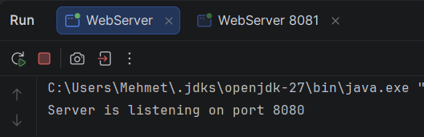
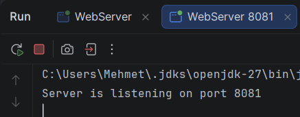
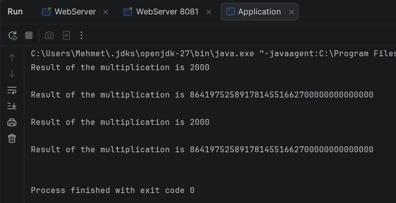

# Asynchronous HTTP Client with Result Aggregation

A Java project that sends HTTP requests to several worker servers **in parallel** and collects their responses into a single ordered list. Built for Lab 2 (Distributed Systems Fundamentals) with `java.net.http.HttpClient` and `CompletableFuture`.

## Table of Contents

- [Overview](#overview)
- [Project Structure](#project-structure)
- [Requirements](#requirements)
- [How It Works](#how-it-works)
- [Getting Started](#getting-started)
- [Example Output](#example-output)
- [Design Notes](#design-notes)
- [Useful Links](#useful-links)

## Overview

The project has three parts:

| Component | Role |
|-----------|------|
| `WebServer` | A ready-made HTTP server (worker). It multiplies all numbers it receives and returns the result. |
| `WebClient` | Sends a single asynchronous HTTP `POST` request, optionally with a custom header. |
| `Aggregator` | Sends one task to each worker at the same time and returns all results in the original order. |

## Project Structure

```
network-communication-master/
├── httpserver/
│   └── src/main/java/WebServer.java        # Worker server (provided)
└── httpclient/
    └── src/main/java/
        ├── WebClient.java                  # Async POST requests
        ├── Aggregator.java                 # Parallel dispatch + result collection
        └── Application.java                # Runnable example
```

## Requirements

- JDK 17 or newer (developed and tested with JDK 27)
- Maven (bundled with IntelliJ IDEA)
- IntelliJ IDEA (recommended)

## How It Works

### `WebClient`

- `sendTask(String url, byte[] requestPayload)`
  Sends an HTTP `POST` request whose body is `requestPayload` using `HttpClient.sendAsync`. It returns immediately with a `CompletableFuture<String>` that completes with the response body.
- `sendTask(String url, byte[] requestPayload, String headers)`
  Same as above, and additionally attaches a custom header. The `headers` argument uses the `Name: value` format (for example `X-Debug: true`) and is split at the first `:`. A malformed header throws `IllegalArgumentException`.

### `Aggregator`

- `sendTasksToWorkers(List<String> workersAddresses, List<String> tasks)`
- `sendTasksToWorkers(List<String> workersAddresses, List<String> tasks, String headers)`

Task *i* is sent to worker *i*. The work happens in two phases:

1. **Dispatch**: every request is started without waiting for any response, so all workers run concurrently.
2. **Collection**: the futures are read in creation order with `join()`, so the result list matches the order of the tasks.

If the number of workers differs from the number of tasks, an `IllegalArgumentException` is thrown. When `headers` is provided, it is applied to every request.

### `WebServer` (provided)

- Accepts `POST` requests on `/task`.
- Splits the request body on commas, multiplies all numbers using `BigInteger`, and responds with `Result of the multiplication is <result>`.
- If the request contains `X-Debug: true`, the response includes an `X-Debug-Info` header with the processing time.
- Exposes `GET /status`, which returns `Server is alive`.

## Getting Started

1. **Open** the `network-communication-master` folder in IntelliJ IDEA and make sure both `httpserver/pom.xml` and `httpclient/pom.xml` are loaded as Maven projects.
2. **Start the first worker** by running `WebServer` (default port `8080`).
3. **Start the second worker** by running `WebServer` again with program argument `8081`. In *Run → Edit Configurations*, enable *Allow multiple instances* for this.
4. **Run** `Application` from the `httpclient` module.

The example sends these tasks:

| Worker | Task |
|--------|------|
| `http://localhost:8080/task` | `10,200` |
| `http://localhost:8081/task` | `123456789,100000000000000,700000002342343` |

Each set is sent twice: once without headers and once with `X-Debug: true`.

## Example Output

### 1. Worker server on port 8080



### 2. Worker server on port 8081



### 3. Running `Application` (client output)



Text version of the output:

```
Result of the multiplication is 2000

Result of the multiplication is 8641975258917814551662700000000000000

Result of the multiplication is 2000

Result of the multiplication is 8641975258917814551662700000000000000
```

The first two lines come from the request without headers. The last two come from the request with the `X-Debug: true` header.
## Design Notes

- **Non-blocking requests:** `sendAsync` returns a `CompletableFuture`, so the thread is never blocked while a request is in flight.
- **Parallelism before waiting:** all futures are created before the first `join()`. Joining inside the dispatch loop would make the requests run one after another.
- **Deterministic ordering:** results are collected in the same order the tasks were submitted, regardless of which worker answers first.
- **Input validation:** mismatched list sizes and malformed header strings fail fast with a clear exception message.

## Useful Links

- [HttpServer class](https://docs.oracle.com/javase/8/docs/jre/api/net/httpserver/spec/com/sun/net/httpserver/HttpServer.html)
- [HttpClient class](https://docs.oracle.com/en/java/javase/11/docs/api/java.net.http/java/net/http/HttpClient.html)
- [HttpRequest class](https://docs.oracle.com/en/java/javase/11/docs/api/java.net.http/java/net/http/HttpRequest.html)
- [SLF4J Logback tutorial](https://mkyong.com/logging/slf4j-logback-tutorial/)
